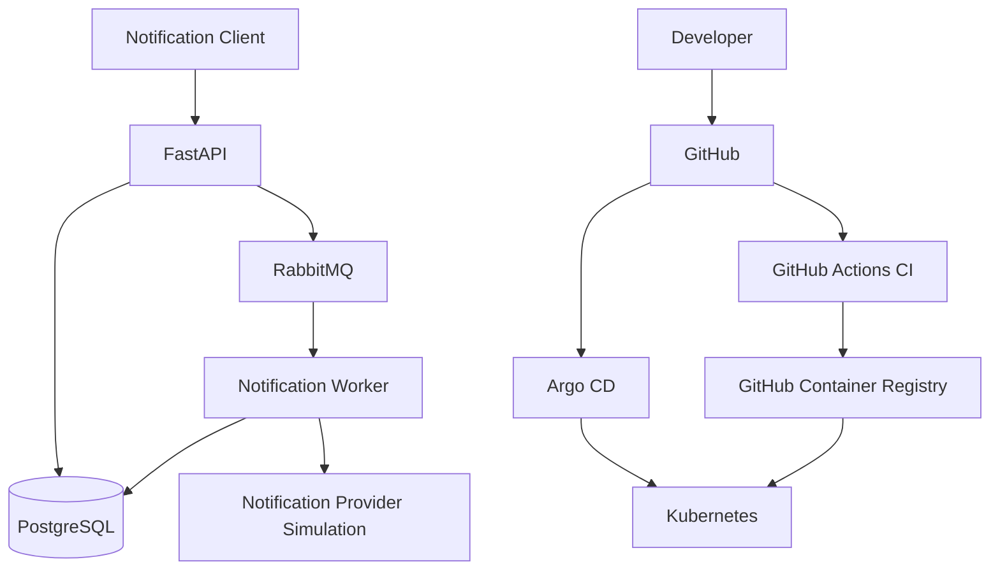

# Event-Driven Notification Platform

A cloud-native notification platform built to demonstrate event-driven architecture, asynchronous processing, containerization, Kubernetes orchestration, and GitOps-based delivery.

## Project Goals

* Build a REST API for accepting notification requests.
* Publish notification events to RabbitMQ.
* Process events asynchronously using a dedicated worker.
* Persist notification records and processing status in PostgreSQL.
* Package services using Docker and Helm.
* Automate testing, image building, and security checks using GitHub Actions.
* Deploy and reconcile Kubernetes resources using Argo CD.
* Practice production-oriented observability, reliability, and security.

## Planned Architecture

## Technology Stack

| Area                       | Technology                |
| -------------------------- | ------------------------- |
| API                        | Python, FastAPI           |
| Message broker             | RabbitMQ                  |
| Database                   | PostgreSQL                |
| Background processing      | Python worker             |
| Containers                 | Docker                    |
| Container registry         | GitHub Container Registry |
| CI automation              | GitHub Actions            |
| GitOps continuous delivery | Argo CD                   |
| Orchestration              | Kubernetes                |
| Packaging                  | Helm                      |
| Security scanning          | Trivy                     |
| Monitoring                 | Prometheus and Grafana    |

## Learning Roadmap

1. Application design and API implementation
2. Event publishing and asynchronous consumption
3. Database persistence and notification status tracking
4. Unit testing and failure handling
5. Docker images and local integration
6. Kubernetes manifests and Helm charts
7. GitHub Actions CI pipeline
8. Argo CD GitOps deployment
9. Security, monitoring, and documentation

## Project Status

**Status:** Initial setup

Features will be marked complete as they are implemented and tested.

## Cost-Conscious Development

The project will prioritize free-tier and local development options where practical. Managed infrastructure and paid services will only be introduced when necessary and explicitly discussed.

## License

MIT License — to be added with the project license file.
